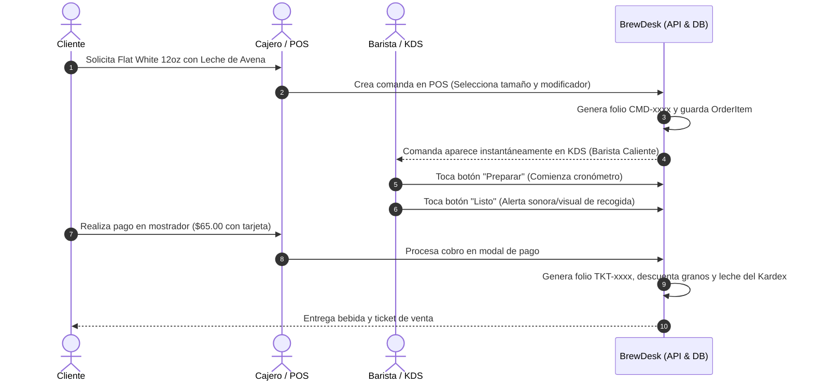

# ☕ BrewDesk — Arquitectura y Funcionamiento Técnico del Sistema

Este documento describe a detalle la arquitectura, componentes, modelos de datos, flujos de operación y reglas de negocio del sistema **BrewDesk** en su estado actual.

---

## 📑 Tabla de Contenidos

1. [Visión General del Sistema](#1-visión-general-del-sistema)
2. [Arquitectura Monorepo](#2-arquitectura-monorepo)
3. [Reglas de Negocio Críticas (Principios Fundamentales)](#3-reglas-de-negocio-críticas-principios-fundamentales)
4. [Modelo de Base de Datos y Esquema Prisma](#4-modelo-de-base-de-datos-y-esquema-prisma)
5. [Módulos del Backend (API Express 5)](#5-módulos-del-backend-api-express-5)
6. [Módulos del Frontend (React 19 + Zustand)](#6-módulos-del-frontend-react-19--zustand)
7. [Modo Híbrido: API en Vivo vs. Modo Demo / Offline](#7-modo-híbrido-api-en-vivo-vs-modo-demo--offline)
8. [Seguridad y Control de Acceso](#8-seguridad-y-control-de-acceso)
9. [Flujos Operativos Paso a Paso](#9-flujos-operativos-paso-a-paso)

---

## 1. Visión General del Sistema

**BrewDesk** es una solución integral de punto de venta (POS), sistema de pantallas para barista/cocina (KDS), control de inventario con costeo por recetas (BOM/Kardex), arqueo de caja y fidelización de clientes, diseñada específicamente para cafeterías de especialidad y negocios gastronómicos ágiles.

### Objetivo
Eliminar el descontrol de inventarios (leches vegetales, café en grano, jarabes), evitar discrepancias en caja chica, acelerar la toma de comandas en mostrador y mesas, y sincronizar la barra de baristas en tiempo real sin tickets de papel perdidos.

---

## 2. Arquitectura Monorepo

El proyecto está organizado como un **Monorepo gestionado con pnpm workspaces**:

```
Sistema de Gestión y Control de Cafeterías/
├── apps/
│   ├── api/                      # Backend REST API
│   │   ├── prisma/
│   │   │   ├── schema.prisma     # Modelado de datos PostgreSQL
│   │   │   └── seed.ts           # Semilla de datos iniciales
│   │   └── src/
│   │       ├── db/               # Instancia de Prisma Client
│   │       ├── modules/          # Arquitectura modular por dominio
│   │       │   ├── auth/         # Autenticación JWT y PIN
│   │       │   ├── cash/         # Turnos y movimientos de caja
│   │       │   ├── customers/    # Clientes y lealtad
│   │       │   ├── dashboard/    # KPIs y analítica ejecutiva
│   │       │   ├── inventory/    # Stock, Kardex y ajustes
│   │       │   ├── orders/       # Comandas y KDS
│   │       │   ├── products/     # Catálogo, variantes y modificadores
│   │       │   └── sales/        # Cobro, tickets y pagos mixtos
│   │       ├── shared/           # Middlewares y utilidades compartidas
│   │       └── types/            # Tipados extendidos de Express
│   │
│   └── web/                      # Frontend SPA
│       └── src/
│           ├── components/       # Componentes visuales y layout
│           ├── lib/              # Clientes API, Supabase y mockData
│           ├── pages/            # Vistas principales (POS, KDS, Caja, etc.)
│           ├── store/            # Gestores de estado global Zustand
│           └── styles/           # Tailwind CSS v4 y tema BrewDesk
├── docs/                         # Documentación técnica y funcional
├── .env.example                  # Plantilla de variables de entorno
├── .gitignore                    # Reglas de exclusión para Git
├── package.json                  # Scripts raíz del monorepo
├── pnpm-workspace.yaml           # Definición de workspaces
└── README.md                     # Portal de bienvenida y guía de inicio
```

---

## 3. Reglas de Negocio Críticas (Principios Fundamentales)

BrewDesk fue diseñado bajo 5 principios de ingeniería inmutables:

### 1. Dinero en Centavos Enteros (`Int`)
- **Nunca se usan números flotantes (`Float` / `Double`) para montos monetarios.**
- Todo precio, descuento, subtotal, impuesto, propina y cambio se almacena y calcula en centavos (`$45.50` = `4550`).
- **Motivo:** Evita errores de redondeo de punto flotante de la norma IEEE 754 comunes en JavaScript y bases de datos.
- Utilidades en `apps/api/src/shared/utils/money.utils.ts` formatean a string visual (`formatCentsToCurrency(4550)` -> `$45.50 MXN`).

### 2. Folios Atómicos Consecutivos
- Cada ticket (`TKT-0001`) y comanda (`CMD-0001`) obtiene su folio a través de la tabla `folio_counters`.
- El incremento se ejecuta mediante transacciones atómicas de base de datos (`ON CONFLICT DO UPDATE`), garantizando que jamás existan dos tickets con el mismo número ni huecos por concurrencia.

### 3. Kardex de Inventario Inmutable
- La tabla `inventory_movements` es un libro mayor contable append-only: **ningún registro se actualiza o elimina**.
- Cada entrada, venta, merma o calibración de molino genera un registro con `stockBefore`, `stockAfter`, `costCentsSnapshot`, motivo y usuario responsable.

### 4. Explosión de Recetas (BOM - Bill of Materials) en Tiempo Real
- Cada producto vendido descuenta automáticamente sus insumos según su receta (`Recipe` + `RecipeIngredient`), incluyendo el porcentaje de merma programado.
- Si el cliente añade modificadores (ej. "Leche de Avena"), el modificador descuenta directamente la cantidad parametrizada del insumo correspondiente.

### 5. Arqueo y Corte de Caja Ciego
- Al cerrar turno (`CashSession`), el cajero realiza un conteo ciego sin ver el total esperado del sistema.
- El sistema calcula la diferencia (`cashDifferenceCents = actualCashCents - expectedCashCents`), identificando sobrantes o faltantes para auditoría inmediata.

---

## 4. Modelo de Base de Datos y Esquema Prisma

El modelo relacional está compuesto por 11 dominios clave en `schema.prisma`:

| Dominio | Modelos Prisma | Propósito |
|---|---|---|
| **Configuración** | `BusinessSetting` | Datos de la cafetería, RFC, moneda, impuestos, propinas sugeridas, textos de ticket. |
| **Auditoría** | `AuditLog` | Registro forense de acciones sensibles (cancelaciones, cortes, modificaciones de precio). |
| **Usuarios** | `User` | Credenciales, rol (`admin`, `manager`, `cashier`, `barista`, `waiter`), PIN numérico. |
| **Folios** | `FolioCounter` | Secuencias atómicas con relleno de ceros (padding). |
| **Salón** | `TableArea`, `RestaurantTable` | Áreas (Salón, Terraza, Barra), mesas, capacidad, coordenadas `(x, y)` y estatus. |
| **Catálogo** | `Category`, `Product`, `ProductVariant`, `ModifierGroup`, `Modifier`, `ProductModifierGroup` | Productos, tamaños (8oz, 12oz, 16oz), grupos de extras obligatorios/opcionales con sobreprecio. |
| **Inventario** | `InventoryItem`, `Recipe`, `RecipeIngredient`, `InventoryMovement` | Insumos (gr, ml, pza), recetas por variante, factores de merma y Kardex inmutable. |
| **Comandas** | `Order`, `OrderItem`, `OrderItemModifier` | Comandas para mesa o llevar, estaciones KDS, tiempos de preparación y estados de cocina. |
| **Ventas** | `Sale`, `SalePayment` | Tickets cobrados, desglose fiscal, propinas, pagos combinados (efectivo, tarjetas, QR). |
| **Caja** | `CashRegister`, `CashSession`, `CashMovement` | Cajas físicas, turnos, corte X (parcial), corte Z (cierre final), fondo de caja y gastos menores. |
| **Lealtad** | `Customer` | Clientes por teléfono, puntos acumulados, visitas y notas de preferencias/alergias. |

---

## 5. Módulos del Backend (API Express 5)

La API expone los siguientes endpoints REST estructurados con validación Zod y protección de roles:

### Autenticación (`/api/auth`)
- `POST /api/auth/login`: Autenticación con email y contraseña.
- `POST /api/auth/pin-login`: Autenticación rápida táctil mediante PIN de 4 dígitos.
- `GET /api/auth/me`: Datos del usuario autenticado actual.

### Catálogo de Productos (`/api/products`)
- `GET /api/products`: Lista de productos con variantes y modificadores.
- `POST /api/products`: Creación de nuevo producto (requiere rol `admin` o `manager`).
- `PUT /api/products/:id`: Edición de producto.
- `PATCH /api/products/:id/availability`: Conmutador rápido de disponibilidad (activo/inactivo).
- `GET /api/products/categories`: Categorías del menú.

### Comandas y Órdenes (`/api/orders`)
- `GET /api/orders`: Listado de órdenes activas (filtro por mesa o estado).
- `POST /api/orders`: Creación de comanda y despacho automático a estaciones KDS.
- `GET /api/orders/:id`: Detalle completo con ítems y modificadores.
- `PATCH /api/orders/:id/status`: Transición de estado (`open` -> `in_preparation` -> `served` -> `paid` -> `cancelled`).
- `PATCH /api/orders/items/:itemId/kds-status`: Actualización de estado en pantalla KDS (`pending`, `preparing`, `ready`, `delivered`).

### Ventas y Facturación de Tickets (`/api/sales`)
- `POST /api/sales`: Cierre de comanda y cobro de venta. Procesa pagos mixtos, calcula cambio en efectivo, genera ticket `TKT-xxxx` y descuenta inventario transaccionalmente.
- `GET /api/sales`: Historial de ventas con filtros de fecha y turno.
- `GET /api/sales/:id`: Detalle de ticket para re-impresión.

### Control de Caja (`/api/cash`)
- `GET /api/cash/current-session`: Estado del turno activo de la caja.
- `POST /api/cash/open-session`: Apertura de turno con fondo inicial.
- `POST /api/cash/close-session`: Cierre de turno (Corte Z) con arqueo ciego.
- `POST /api/cash/movement`: Registro de entrada/salida de dinero (caja chica).
- `GET /api/cash/sessions`: Historial de cortes y sesiones anteriores.

### Inventario y Kardex (`/api/inventory`)
- `GET /api/inventory/items`: Lista de insumos con semáforo de stock (óptimo, bajo, crítico).
- `POST /api/inventory/movements`: Registro manual de entrada, merma o ajuste con motivo.
- `GET /api/inventory/kardex/:itemId`: Historial cronológico de movimientos de un insumo.

### Tablero de Control (`/api/dashboard`)
- `GET /api/dashboard/stats`: Indicadores ejecutivos en tiempo real (ventas del día, ticket promedio, órdenes en proceso, insumos por agotarse y top de ventas).

---

## 6. Módulos del Frontend (React 19 + Zustand)

El frontend está desarrollado en React 19 con Vite, utilizando Tailwind CSS v4 para una experiencia táctil ultra-fluida optimizada para tablets y pantallas táctiles de mostrador:

### 1. Punto de Venta Táctil (`PosPage.tsx`)
- Cuadrícula de categorías con filtrado instantáneo y buscador por nombre o SKU.
- Diálogo flotante interactivo para productos con variantes (tamaños) y grupos de modificadores (leches, jarabes, extras).
- Carrito de compras reactivo en panel lateral con selector de comensales, mesa asignada o pedido "Para llevar".
- Modal de pago completo con cálculo automático de cambio, desglose de propina sugerida (10%, 15%, 20% o libre) y selección de método de pago (Efectivo, Tarjeta, Transferencia o Mixto).

### 2. KDS - Pantalla de Producción para Baristas (`KdsPage.tsx`)
- Interfaz de alto contraste diseñada para la barra de café y cocina.
- Filtro por estación: **Barista Caliente** (espresso, latte, cappuccino), **Barista Frío** (cold brew, frappé), **Cocina** (alimentos) y **Todos**.
- Semáforo de tiempo transcurrido por tarjeta:
  - 🟢 **Normal**: < 4 minutos
  - 🟡 **Atención**: 4 a 7 minutos
  - 🔴 **Urgente / Retraso**: > 7 minutos
- Avance de estados táctil con un solo toque (`Iniciar` -> `Marcar Listo` -> `Entregado`).

### 3. Control de Caja y Arqueo (`CashPage.tsx`)
- Panel de sesión de caja activa con indicador de estado (Abierta / Cerrada).
- Formulario de apertura de turno con fondo inicial.
- Registro rápido de gastos menores y retiros parciales de seguridad.
- Resumen de ventas acumuladas por medio de pago (Efectivo, Tarjetas, Transferencias).
- Módulo de Corte de Caja con conteo de billetes y monedas, cálculo automático de diferencia y generación de reporte de cierre.

### 4. Inventario y Control de Insumos (`InventoryPage.tsx`)
- Vista de catálogo de insumos con métricas de stock actual vs. stock mínimo.
- Píldoras visuales de estatus: `Stock Óptimo`, `Stock Bajo` y `Agotado`.
- Formulario para registro de entradas de compras y mermas por calibración o caducidad.
- Visualizador de Kardex para auditoría de trazabilidad de cada insumo.

### 5. Catálogo de Productos y Recetas (`ProductsPage.tsx`)
- Administración de catálogo, categorías, precios y asignación de estación de preparación.
- Conmutador rápido de disponibilidad para agotar productos temporalmente en mostrador.

### 6. Dashboard Ejecutivo (`DashboardPage.tsx`)
- Tarjetas de KPIs clave del día: Total Vendido, Tickets emitidos, Ticket promedio, Alertas de stock.
- Gráficas interactivas con Recharts (ventas por hora, productos más populares).

---

## 7. Modo Híbrido: API en Vivo vs. Modo Demo / Offline

Para garantizar que el sistema pueda presentarse, evaluarse y funcionar en cualquier entorno, el cliente HTTP (`apps/web/src/lib/api.ts`) cuenta con **detección inteligente de backend**:

1. **Modo Conectado (Producción / Local con API activa):**
   - El frontend se comunica vía HTTP con Express en `http://localhost:3001` y Supabase.
   - Las transacciones se persisten en PostgreSQL.
2. **Modo Demo Autónomo (Fallback Automático):**
   - Si el servidor backend no responde o no está iniciado, el frontend conmuta de forma transparente al motor de datos en memoria y `localStorage` (`mockData.ts`).
   - Permite crear comandas, simular cobros, mover tarjetas en el KDS, registrar entradas de inventario y abrir/cerrar caja sin interrupciones.

---

## 8. Seguridad y Control de Acceso

- **Criptografía de contraseñas:** `bcryptjs` con salt rounds = 10.
- **Tokens de sesión:** JWT firmados con algoritmo HMAC SHA-256 y expiración configurable (por defecto 8 horas para turnos de trabajo).
- **Protección HTTP:** Cabeceras seguras con `helmet`, limitación de tasa contra ataques de fuerza bruta (`express-rate-limit`) y `cors` restringido.
- **Control de Acceso Basado en Roles (RBAC):**
  - `admin`: Acceso completo sin restricciones.
  - `manager`: Reportes, catálogo, recetas, inventario y caja.
  - `cashier`: POS, cobro, corte de caja y catálogo en modo lectura.
  - `barista`: Acceso exclusivo a la pantalla KDS de barra y cocina.
  - `waiter`: Toma de comandas de mesa y pedidos para llevar.

---

## 9. Flujos Operativos Paso a Paso

### Flujo A: Ciclo de una Orden desde el Mostrador hasta la Entrega


### Flujo B: Descuento Transaccional de Inventario (BOM)
Al pagar un `Flat White 12oz con Leche de Avena`:
1. El sistema lee la receta (`Recipe`) del producto:
   - Requiere `18.0 g` de Café Grano Chiapas.
   - Requiere `220.0 ml` de Leche.
2. Identifica el modificador `Leche de Avena`:
   - Sustituye la leche entera y enlaza al insumo `Leche de Avena (ml)`.
3. En una sola transacción Prisma:
   - Descuenta `18g` del insumo `Café Grano Chiapas`.
   - Descuenta `220ml` del insumo `Leche de Avena`.
   - Inserta dos registros en `inventory_movements` vinculados a la venta.
