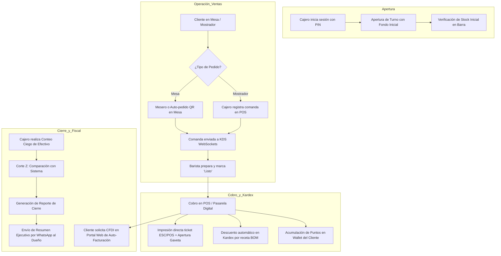

# 🚀 BrewDesk — Visión, Especificación y Roadmap de la Fase Terminada

Este documento detalla la visión completa de **BrewDesk** en su **Fase Terminada (Producción Enterprise)**, describiendo cómo debe operar el sistema al 100%, los módulos pendientes y planeados, las integraciones de hardware y servicios externos, la arquitectura de alta disponibilidad y el roadmap estructurado para alcanzar la versión final.

---

## 📑 Tabla de Contenidos

1. [Visión Estratégica del Producto Final](#1-visión-estratégica-del-producto-final)
2. [Comparativa: Fase Actual vs. Fase Terminada](#2-comparativa-fase-actual-vs-fase-terminada)
3. [Módulos Nuevos y Mejoras de la Fase Terminada](#3-módulos-nuevos-y-mejoras-de-la-fase-terminada)
   - [3.1 Integración de Hardware POS Nativo (ESC/POS)](#31-integración-de-hardware-pos-nativo-escpos)
   - [3.2 Facturación Electrónica Fiscal Automatizada (CFDI / Fiscal Local)](#32-facturación-electrónica-fiscal-automatizada-cfdi--fiscal-local)
   - [3.3 Auto-Pedido en Mesa vía Código QR y Pagos Digitales](#33-auto-pedido-en-mesa-vía-código-qr-y-pagos-digitales)
   - [3.4 Arquitectura Multi-Sucursal y Bodega Central (Multi-Tenant)](#34-arquitectura-multi-sucursal-y-bodega-central-multi-tenant)
   - [3.5 Módulo Integral de Compras, Proveedores y Cuentas por Pagar](#35-módulo-integral-de-compras-proveedores-y-cuentas-por-pagar)
   - [3.6 Motor de Fidelización, CRM y Tarjeta Digital (Apple/Google Wallet)](#36-motor-de-fidelización-crm-y-tarjeta-digital-applegoogle-wallet)
   - [3.7 Modo Offline-First Real con Sincronización Bidireccional (PWA)](#37-modo-offline-first-real-con-sincronización-bidireccional-pwa)
   - [3.8 Bot de Notificaciones y Alertas Críticas (WhatsApp / Telegram)](#38-bot-de-notificaciones-y-alertas-críticas-whatsapp--telegram)
4. [Flujo Operativo Integral en Producción](#4-flujo-operativo-integral-en-producción)
5. [Matriz de Roles y Permisos Definitiva (RBAC Granular)](#5-matriz-de-roles-y-permisos-definitiva-rbac-granular)
6. [Roadmap de Implementación por Fases](#6-roadmap-de-implementación-por-fases)
7. [Criterios de Aceptación y Checklist de Certificación Final](#7-criterios-de-aceptación-y-checklist-de-certificación-final)

---

## 1. Visión Estratégica del Producto Final

En su fase terminada, **BrewDesk** debe consolidarse como un ecosistema operativo de nivel empresarial para cafeterías y tostadurías de especialidad, desde un local boutique independiente hasta una cadena franquiciada de 50+ sucursales.

El sistema terminado no requerirá intervención manual para tareas repetitivas:
- Las ventas se timbran automáticamente ante las entidades tributarias.
- Las impresoras de barra y caja imprimen tickets sin ventanas de diálogo de Windows.
- Los clientes ordenan desde su celular mediante códigos QR dinámicos.
- Los baristas reciben órdenes en KDS sincronizados en milisegundos mediante WebSockets.
- Las existencias de insumos se descuentan al gramo y disparan órdenes de compra automáticas a los proveedores de café y leche cuando el stock baja del umbral de seguridad.

---

## 2. Comparativa: Fase Actual vs. Fase Terminada

| Característica / Módulo | Estado Actual (Fase MVP / Beta) | Estado Objetivo (Fase Terminada) |
|---|---|---|
| **Punto de Venta (POS)** | Web táctil con carrito, variantes, modificadores y cobro simulado/API. | Integrado con periféricos físicos (gaveta de dinero, escáner láser, terminal bancaria). |
| **Impresión de Tickets** | Generación de ticket en pantalla / diálogo de impresión del navegador. | Impresión directa ESC/POS por WebUSB, Bluetooth y TCP/IP Ethernet a 80mm y 58mm. |
| **KDS (Cocina/Barra)** | Pantalla reactiva con estados, tiempos y semáforo de alerta. | Pantalla con alertas sonoras (chime/beep), pedalera de avance para baristas con manos ocupadas y dispatch inteligente. |
| **Facturación** | Registro de ventas y folios internos `TKT-xxxx`. | Timbrado fiscal electrónico (CFDI 4.0 en México u homólogos) + Portal de autofacturación web con QR. |
| **Conexión a Internet** | Modo API con fallback a mockData local si no hay servidor. | PWA Offline-First con IndexedDB y sincronización en segundo plano mediante Service Workers y resolución de conflictos. |
| **Salón y Mesas** | Asignación de mesa en orden desde el POS. | Mapa visual interactivo 2D del salón (drag & drop), cambio de mesa, unión de cuentas y auto-pedido por QR. |
| **Inventario y Recetas** | Catálogo de insumos, semáforo de stock, recetas BOM y Kardex. | Costeo promedio ponderado, control de lotes con fechas de caducidad, órdenes de compra a proveedores y auditoría con escáner. |
| **Múltiples Sucursales** | Base de datos mono-sucursal. | Soporte Multi-Tenant: catálogo central, precios diferenciados, transferencias entre sucursales y dashboard consolidado. |
| **Fidelización** | Registro de cliente con teléfono, puntos y notas de preferencia. | Monedero electrónico con Apple Wallet / Google Wallet, campañas por WhatsApp y recompensas dinámicas. |
| **Alertas** | Notificaciones en pantalla en el dashboard. | Notificaciones push en tiempo real a administradores vía bot de Telegram o WhatsApp ante mermas o descuadres de caja. |

---

## 3. Módulos Nuevos y Mejoras de la Fase Terminada

### 3.1 Integración de Hardware POS Nativo (ESC/POS)
- **Protocolo ESC/POS:** Comunicación nativa con impresoras térmicas (Epson, Star Micronics, Xprinter, Bixolon) mediante API WebUSB / Web Serial o un micro-servicio local en bandeja del sistema (*Tray Agent* en Go o Rust).
- **Apertura de Gaveta de Dinero (Cash Drawer):** Envío automático del pulso de solenoide `ESC p 0 25 250` al cajón de dinero al confirmar un pago en efectivo.
- **Terminales de Pago Integradas (Smart POS):**
  - Integración vía SDK / Webhooks con terminales como Clip Pro, Mercado Pago Point Smart o Stripe Terminal.
  - Al seleccionar "Pago con Tarjeta", el POS envía el monto exacto a la terminal física sin que el cajero deba digitarlo manualmente, eliminando errores de digitación humana.
- **Básculas Digitales (RS-232 / USB HID):** Lectura en vivo del peso en gramos para venta a granel de café de especialidad y microlotes.

### 3.2 Facturación Electrónica Fiscal Automatizada (CFDI / Fiscal Local)
- **Generación de Comprobantes Fiscales:**
  - Integración con PAC (Proveedor Autorizado de Certificación en México como Finkok, Facturapi o SW Sapience).
  - Emisión de CFDI 4.0 de Ingreso con desglose de IVA (16%), IEPS y retenciones según aplique.
- **Portal de Auto-Facturación para el Cliente:**
  - Cada ticket impreso contendrá una URL corta y un código QR con un token criptográfico único.
  - El cliente escanea el QR desde su smartphone, introduce su RFC, Razón Social, Régimen Fiscal y Código Postal, y descarga su XML y PDF al instante.
- **Cancelaciones Fiscales:** Flujo de cancelación ante la autoridad fiscal con motivo reglamentario (ej. motivo 02: con error sin relación).

### 3.3 Auto-Pedido en Mesa vía Código QR y Pagos Digitales
- **QR Dinámico por Mesa:**
  - Código QR generado para cada mesa física que abre la Web App de comensal sin necesidad de descargar apps.
  - Menú interactivo con fotos de alta resolución, descripción de notas de cata del café (acidez, cuerpo, origen, altura).
- **Comanda Directa:** Las órdenes creadas por los clientes ingresan directamente al KDS del barista con la etiqueta `Mesa X - Auto-pedido`.
- **Cobro Digital en Mesa:** El comensal puede liquidar su cuenta directamente desde el teléfono con tarjetas de crédito/débito, Apple Pay o Google Pay, dejando propina digital sugerida.

### 3.4 Arquitectura Multi-Sucursal y Bodega Central (Multi-Tenant)
- **Organización Jerárquica:**
  - Nivel Empresa (Tenant) -> Nivel Sucursales (Branches) -> Nivel Estaciones / Cajas.
- **Catálogo Central vs. Menú Local:**
  - Posibilidad de definir productos globales y activar/desactivar o cambiar precios en sucursales específicas según la zona geográfica.
- **Traspasos de Inventario:**
  - Solicitud de insumos de sucursal a Bodega Central con orden de embarque, confirmación de recepción y ajuste automático de Kardex en ambas ubicaciones.
- **Analítica Consolidada:** Comparativa de rendimiento entre sucursales, horarios pico y productos más rentables en un solo panel de control.

### 3.5 Módulo Integral de Compras, Proveedores y Cuentas por Pagar
- **Directorio de Proveedores:** Datos de contacto, condiciones comerciales (días de crédito), catálogo de insumos que surte cada proveedor.
- **Órdenes de Compra (OC):** Flujo de creación, aprobación gerencial, envío en PDF por email y recepción con cotejo ciego de cantidades.
- **Costeo Promedio Ponderado (CPP):** Cada compra recalcula el costo unitario real del insumo y actualiza los márgenes brutos de las recetas.
- **Módulo de Mermas Avanzado:** Registro de desperdicio clasificado: caducidad, calibración de molino diario, rotura o error de preparación, con reporte de pérdida financiera mensual.

### 3.6 Motor de Fidelización, CRM y Tarjeta Digital (Apple/Google Wallet)
- **Pase Digital en Apple Wallet / Google Wallet:**
  - El cliente recibe un link para agregar su tarjeta virtual a su teléfono.
  - La tarjeta muestra su saldo en puntos, nivel de cliente (Bronce, Plata, Oro) y código de barras/QR para escanear en caja.
- **Reglas de Puntos Dinámicas:**
  - Configuración de factor de acumulación (ej. 5% de la compra se convierte en BrewPoints).
  - Canje de puntos como forma de pago parcial o total en el POS.
- **Campañas Automatizadas:** Notificación automática en el teléfono del cliente: *"Te extrañamos, ven hoy por tu cappuccino y obtén un 20% de descuento"*.

### 3.7 Modo Offline-First Real con Sincronización Bidireccional (PWA)
- **Base de Datos Local (IndexedDB / SQLite en Tauri):**
  - Todas las ventas, comandas y cortes pueden realizarse al 100% aun si se cae la conexión a internet de la cafetería.
- **Cola de Transacciones Outbox:**
  - Las transacciones se firman con un identificador UUID local y se encolan.
- **Sincronización Silenciosa:**
  - Cuando se restablece la conexión, un Service Worker sincroniza las ventas en segundo plano con el servidor central, resolviendo conflictos de folios y stock de forma transparente.

### 3.8 Bot de Notificaciones y Alertas Críticas (WhatsApp / Telegram)
- **Alertas de Inventario:** Mensaje instantáneo al gerente: *"⚠️ Alerta de Stock: El Café Grano Chiapas está en 850g (Mínimo: 2,000g). Se sugiere reordenar."*
- **Reporte Diario de Cierre (Corte Z):** Al cerrar la última caja del día, el dueño recibe en su WhatsApp el resumen ejecutivo: Ventas totales, ticket promedio, margen de ganancia estimado y si hubo algún faltante o sobrante de efectivo.

---

## 4. Flujo Operativo Integral en Producción

---

## 5. Matriz de Roles y Permisos Definitiva (RBAC Granular)

| Permiso / Módulo | Administrador (`admin`) | Gerente (`manager`) | Cajero (`cashier`) | Barista (`barista`) | Mesero (`waiter`) |
|---|:---:|:---:|:---:|:---:|:---:|
| **Acceso a Dashboard Financiero** | ✅ Total | ✅ Total | ❌ | ❌ | ❌ |
| **Apertura y Cierre de Caja (Corte X/Z)** | ✅ Total | ✅ Total | ✅ Su turno | ❌ | ❌ |
| **Cobro y Emisión de Tickets en POS** | ✅ | ✅ | ✅ | ❌ | ❌ |
| **Cancelar Ventas o Aplicar Descuentos** | ✅ Libre | ✅ Con motivo | 🔒 Requiere PIN Gerente | ❌ | ❌ |
| **Visualizar y Avanzar KDS** | ✅ | ✅ | ✅ | ✅ Exclusivo | ❌ |
| **Toma de Comandas de Mesa** | ✅ | ✅ | ✅ | ❌ | ✅ Exclusivo |
| **Modificar Catálogo de Productos y Precios**| ✅ | ✅ | ❌ | ❌ | ❌ |
| **Configuración de Recetas (BOM)** | ✅ | ✅ | ❌ | ❌ | ❌ |
| **Entradas de Compra en Inventario** | ✅ | ✅ | ❌ | ❌ | ❌ |
| **Registro de Merma / Calibración** | ✅ | ✅ | 🔒 Con PIN | ✅ Barra | ❌ |
| **Configuración Fiscal y Negocio** | ✅ Exclusivo | ❌ | ❌ | ❌ | ❌ |
| **Gestión de Usuarios y Roles** | ✅ Exclusivo | ❌ | ❌ | ❌ | ❌ |

---

## 6. Roadmap de Implementación por Fases

### Fase 1: Consolidación del Core (Estado Actual Completado ✅)
- [x] Monorepo estructurado (Express 5 + React 19 + Tailwind v4 + Zustand).
- [x] Modelado de base de datos relacional Prisma con 11 dominios y convención en centavos enteros.
- [x] POS táctil con categorías, variantes, modificadores y cobro multitipo.
- [x] Pantalla de barista KDS con estados reactivos y cronómetros de preparación.
- [x] Módulo de apertura, control de movimientos y corte de caja.
- [x] Inventario con BOM (Bill of Materials) y Kardex inmutable.
- [x] Dashboard ejecutivo con analítica y gráficos interactivos.
- [x] Modo híbrido (API en vivo + modo demo offline con mockData).

### Fase 2: Hardware POS y Periféricos Físicos (Semanas 1 a 3)
- [ ] Implementación de driver WebUSB / Web Serial para protocolo ESC/POS.
- [ ] Soporte para impresoras térmicas de 58mm y 80mm con corte de papel automático.
- [ ] Comando de apertura de gaveta de dinero en cobro de efectivo.
- [ ] Integración con báscula para venta a granel de café en grano.
- [ ] Soporte para lector de código de barras USB/Bluetooth en productos empaquetados.

### Fase 3: Facturación Fiscal y Auto-Facturación (Semanas 4 a 6)
- [ ] Integración con PAC para timbrado de facturas electrónicas (CFDI 4.0 / Facturación local).
- [ ] Generación de PDF fiscal con cadena digital, sello y código QR bidimensional CBB.
- [ ] Portal público web responsivo para auto-facturación de comensales mediante folio de ticket.
- [ ] Módulo administrativo de reportes fiscales mensuales (IVA cobrado, ventas al público en general).

### Fase 4: Auto-Pedido en Mesa (QR) y Fidelización Digital (Semanas 7 a 9)
- [ ] Generación de códigos QR descargables para impresión en acrílicos de mesa.
- [ ] Web App ligera para comensales (menú con fotos, notas de cata y selección de mesa).
- [ ] Envío directo de órdenes de comensal al KDS con alerta sonora.
- [ ] Integración con pasarelas de pago digitales (Apple Pay, Google Pay, tarjetas).
- [ ] Integración de pases Apple Wallet / Google Wallet para el programa de fidelización.

### Fase 5: Multi-Sucursal, Cadena de Suministro y PWA Offline (Semanas 10 a 12)
- [ ] Arquitectura Multi-Tenant con selector de sucursal para cadenas de cafeterías.
- [ ] Traspasos de almacén entre Bodega Central y sucursales.
- [ ] Módulo de órdenes de compra (OC) a tostadores y proveedores lácteos con costeo promedio ponderado.
- [ ] Service Worker con base de datos local IndexedDB para tolerancia a fallas de internet al 100%.
- [ ] Bot de notificaciones en WhatsApp/Telegram para gerencia con alertas de corte y mermas.

---

## 7. Criterios de Aceptación y Checklist de Certificación Final

Para dar por concluida la fase terminada en un entorno de producción real, el sistema debe superar las siguientes pruebas de certificación:

- [ ] **Prueba de Cero Concurrencia de Folios:** 100 transacciones simultáneas deben generar folios perfectamente correlativos sin saltos ni duplicados.
- [ ] **Prueba de Integridad de Caja:** El cuadre contable entre ventas cobradas, entradas/salidas de caja chica y efectivo contado debe ser exacto al centavo.
- [ ] **Prueba de Resistencia de Barra (KDS):** Una comanda enviada desde el POS o QR debe reflejarse en el KDS en menos de 500 milisegundos.
- [ ] **Prueba de Descuento de Insumos (Kardex):** La preparación de 50 bebidas con modificadores de leche vegetal debe coincidir al mililitro con el inventario físico medido en barra.
- [ ] **Prueba de Desconexión de Red:** El sistema debe permitir seguir cobrando en mostrador e imprimiendo tickets aun si el router de internet se apaga durante 4 horas.
- [ ] **Prueba de Timbrado Fiscal:** Las facturas emitidas deben validar al 100% ante el portal del fisco sin rechazos de esquema o catálogos.
